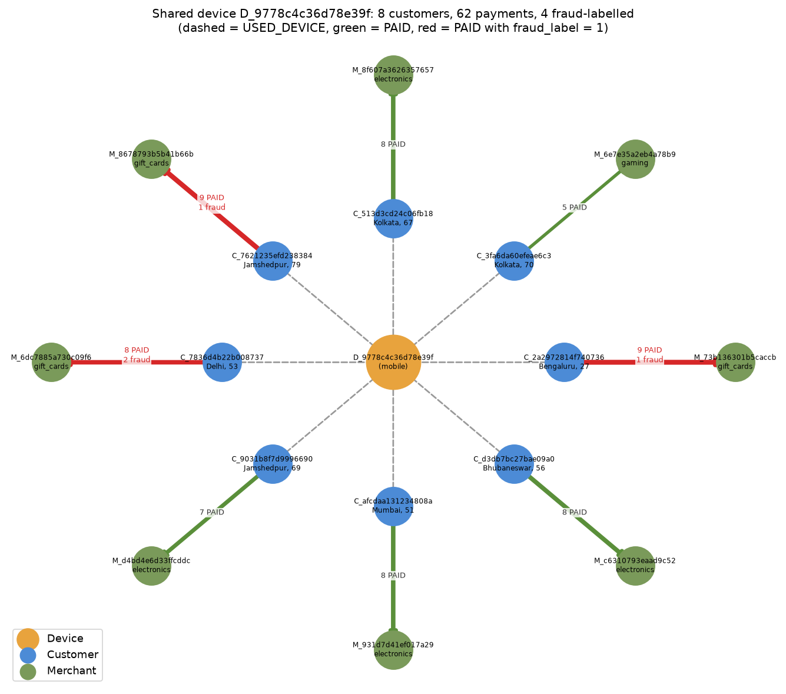

# SENTINEL Graph: finding fraud in relationships with Neo4j

Fraud rings are hard to spot in tables: each payment looks fine on its own row. They show up
when you connect the rows: one phone signing into many accounts, or many "unrelated" customers
paying the same gift-card shop. This project loads SENTINEL transactions into Neo4j as a graph
and uses Cypher to find those patterns.

```
(:Customer)-[:USED_DEVICE {first_seen, last_seen, tx_count}]->(:Device)
(:Customer)-[:PAID {transaction_id, amount, time, fraud_label, channel, device_id}]->(:Merchant)
```

| File | What it does |
|---|---|
| `docker-compose.yml` | Neo4j 5.26 Community on ports 7474 (Browser) and 7687 (Bolt) |
| `common.py` | Reads `.env` and opens a driver checked with `verify_connectivity()` |
| `load_graph.py` | Reads a sample, creates constraints, loads it with `MERGE` |
| `queries.cypher` | Fraud-pattern queries (paste into Browser or run with the script) |
| `run_queries.py` | Runs every query, prints tables, saves `output/*.csv` |
| `visualize_cluster.py` | Draws the most suspicious shared-device cluster to a PNG |

## Setup

You need Docker Desktop and Python 3.10+.

1. **Secrets.** Copy the example file and set your own password (8+ characters):
   ```bash
   cp .env.example .env
   ```
   `.env` is git-ignored. Only `.env.example` (no real values) is committed.

2. **Neo4j.** Start it and wait until it's healthy (about 20 seconds):
   ```bash
   docker compose up -d
   ```
   Browser: http://localhost:7474 (user `neo4j`, password from `.env`).
   To use **Aura** instead, skip Docker and set `NEO4J_URI=neo4j+s://<id>.databases.neo4j.io`
   and the Aura password in `.env`.

3. **Python packages.**
   ```bash
   pip install -r requirements.txt
   ```

4. **Data source** (choose with `SOURCE` in `.env` or `--source`):
   * `csv` (default): the SENTINEL export from Project Work 4/5. Point `CSV_DIR` at the
     `sentinel_data/tables` folder (it contains `transactions/`, `labels/`, `customers/`, `devices/`, `merchants/`).
   * `supabase`: your own Supabase load (`sql/01_create_tables.sql` + `python ingest.py all`).
     Set `SUPABASE_URL` and `SUPABASE_KEY`. Transactions are read through the REST API with the
     label joined in (`labels(fraud_label)`).

   I use `csv` by default because my Supabase load keeps only ~2,100 customers spread across
   14 months: a 20k-row sample from it has only 2 devices that reach 3 customers in a week. The
   CSV export is the full-volume version of the same data, so the same 50k rows cover 6½ weeks
   and contain real device rings.

## How to run

```bash
python load_graph.py            # load 50,000 transactions (SAMPLE_SIZE in .env)
python load_graph.py            # run it again: counts stay the same (idempotent)
python run_queries.py           # all fraud-pattern queries
python visualize_cluster.py     # PNG of the top suspicious cluster
```

Useful options: `python load_graph.py --source supabase --sample 20000`, `--reset` (wipe the graph
first), `python run_queries.py q3 --min-customers 4`.

### Load output (first and second run)

```
Reading 50,000 transactions from csv ...
Reading 15,809 customers, 16,814 devices, 1,998 merchants ...
Connected to Neo4j (verify_connectivity OK)
Loaded 50,000 transactions (2024-09-30 .. 2024-11-15) in 32s
Graph now holds: customers=15,809, devices=16,814, merchants=1,998, paid=50,000, fraud_paid=347, used_device=17,151
```

The second run prints the exact same `Graph now holds` line. Duplicate checks after the second run:
`dup_customers=0, dup_paid=0, dup_used_device=0`.

## Why the load can run twice without duplicates

* **Uniqueness constraints** on `Customer.customer_id`, `Device.device_id`, `Merchant.merchant_id`
  and a relationship uniqueness constraint on `PAID.transaction_id` (one edge per transaction).
  The constraints also act as the indexes that make `MERGE` fast.
* **`MERGE`, never `CREATE`.** Nodes merge on their id, `PAID` merges on `transaction_id`, and
  `USED_DEVICE` merges on the (customer, device) pair.
* **`SET`, never `+=`.** `USED_DEVICE.tx_count`, `first_seen` and `last_seen` are computed in Python
  from the whole sample and then `SET`, so a second run writes the same values instead of doubling them.

```cypher
UNWIND $rows AS r
MATCH (c:Customer {customer_id: r.customer_id})
MATCH (m:Merchant {merchant_id: r.merchant_id})
MERGE (c)-[p:PAID {transaction_id: r.transaction_id}]->(m)
SET p.amount = r.amount, p.time = r.time, p.fraud_label = r.fraud_label,
    p.channel = r.channel, p.device_id = r.device_id
```

## The queries and what they found

All queries are in [`queries.cypher`](queries.cypher). Full output is in `output/run_queries.txt`
after a run. Results below are from the 50k sample: 347 of 50,000 payments (0.69%) are fraud-labelled.

### 1. Devices shared by 3 or more customers within 7 days

Each payment on a device is tried as the start of a 7-day window; the busiest window per device is kept.
`PAID.device_id` lets us check *when* each customer used the device, not just *whether* they did.

```
devices_flagged  max_customers_in_window
             29                        4

            device    kind  customers_in_window  customers_ever  payments_in_window  fraud_in_window window_start window_end
D_9778c4c36d78e39f  mobile                    4               8                  33                3   2024-10-25 2024-11-01
D_585860181f663e45  mobile                    4               6                  29                2   2024-10-31 2024-11-07
D_2630cb01dd62725d  mobile                    4               5                  27                0   2024-10-22 2024-10-29
...
```

**29 devices** had 3+ customers in one week. Payments made from shared devices are **4.0% fraud**
(111 of 2,753), almost 6 times the 0.69% baseline.

### 2. Customers within 2 hops of a fraud-labelled payment

A fraud payment is the edge `(payer)-[:PAID {fraud_label: 1}]->(merchant)`. A customer is within
2 hops if they share a device with the payer (`payer → device ← customer`) or paid the same
merchant (`customer → merchant`). The payer is excluded.

```
fraud_payers  fraud_merchants  via_shared_device  via_fraud_merchant
         299              238                296               2381

          customer  own_fraud  shared_device_links  fraud_merchant_links  linked_fraud_payer_via_device
C_a2f0d558c8d061d8          0                    6                     1  [C_313eb6ccd9f43030 via D_b584eaf27c16c3f0, ...]
C_4ecf05b6c77dfc7c          0                    4                     1  [C_313eb6ccd9f43030 via D_b584eaf27c16c3f0, ...]
...
```

The merchant path is wide (2,381 customers): busy merchants connect many people. The device path
is much narrower (296) and more useful. The top of the list is customers with **no fraud of their
own** who share a device with several fraud payers. Those are the next accounts to review.

### 3. Merchants most often paid from shared devices

```
          merchant                      name    category      city  payments_from_shared_devices  shared_devices  customers  fraud_payments  amount_inr
M_97e979f10c0a0ec9 Synthetic Merchant 000484 electronics Hyderabad                            31               4          4               2   157115.93
M_e7d860ffd6735dcb Synthetic Merchant 001055      gaming     Patna                            26               3          3               1    93993.09
M_5d9264b974537afb Synthetic Merchant 001694 electronics    Indore                            25               4          4               2    78872.92
...
```

All top 15 are **electronics, gaming or gift cards**. These goods are easy to resell or turn into
cash, which is what a fraudster using stolen accounts wants.

## One suspicious cluster: device `D_9778c4c36d78e39f`

`q4_most_suspicious_cluster` ranks shared devices by fraud, then by customers. The top one is drawn
below (`python visualize_cluster.py`). In Neo4j Browser:

```cypher
:param device_id => 'D_9778c4c36d78e39f'
MATCH (d:Device {device_id: $device_id})<-[u:USED_DEVICE]-(c:Customer)
OPTIONAL MATCH (c)-[p:PAID {device_id: d.device_id}]->(m:Merchant)
RETURN d, u, c, p, m
```




**What the graph shows**

* **One mobile phone, 8 customers.** They have nothing in common: ages 27 to 79, home cities from
  Bengaluru to Jamshedpur. Real families share a phone; 8 strangers in 6 cities do not.
* **Each customer appears once, for one day.** Every customer's `first_seen` and `last_seen` on this
  device are the same date, spread from 1 Oct to 10 Nov 2024. The phone works through accounts one at a time.
* **Each visit is a burst of 5 to 9 payments to a single merchant**, always gift cards, electronics
  or gaming. This is the pattern of account takeover: log in, cash out fast, move to the next account.
* **4 of the 62 payments are fraud-labelled (6.5%, 9× the baseline)**. All are gift-card payments by card
  between 01:14 and 03:40 IST.
* **The other 5 customers have no fraud label yet**, but they show the same one-day, one-merchant
  burst on the same phone. In a table each of their payments looks normal. In the graph they are
  clearly part of the ring, so they should be reviewed and the device blocked.

## Notes

* The SENTINEL data is synthetic. Fraud labels and device sharing are simulated.
* All amounts are in INR (`transaction_amount`); times are stored in UTC.
* The queries use plain Cypher (no APOC) and the `CALL () { ... }` subquery syntax, so they need
  Neo4j 5.23 or newer (Aura is fine).
